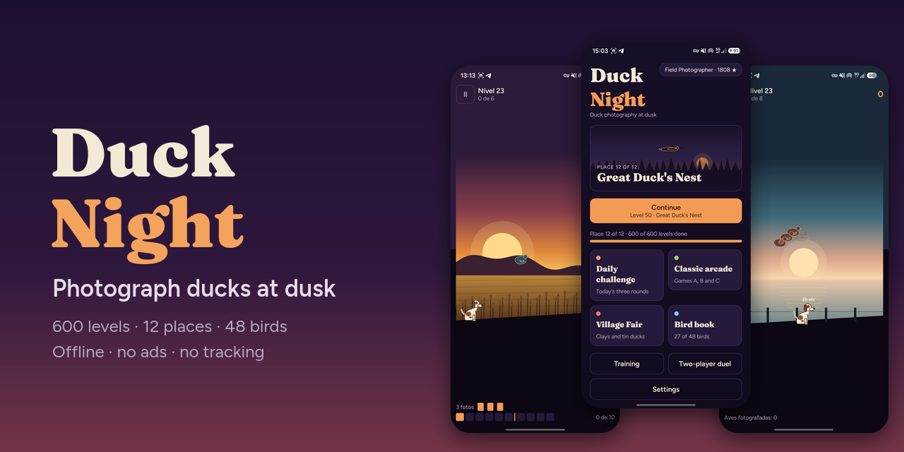
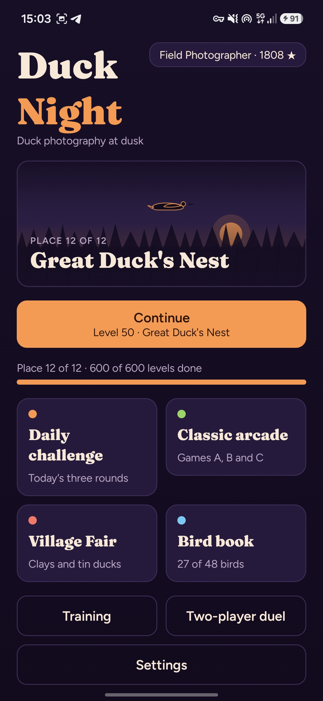
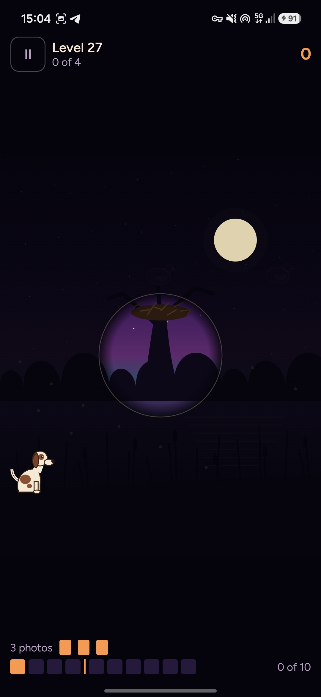
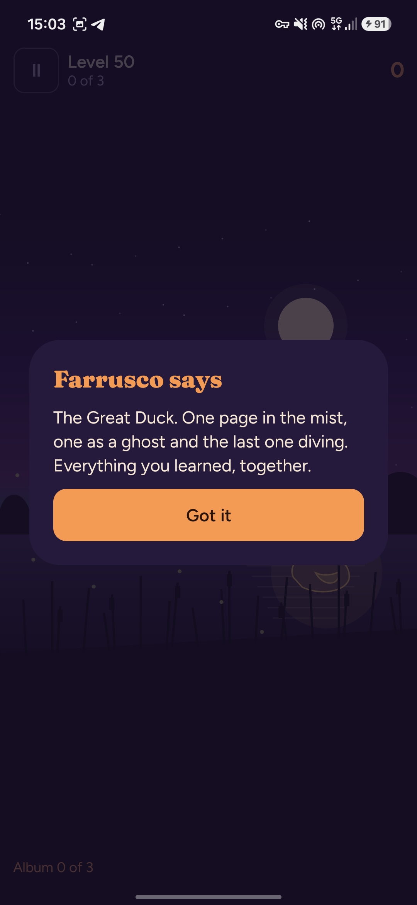
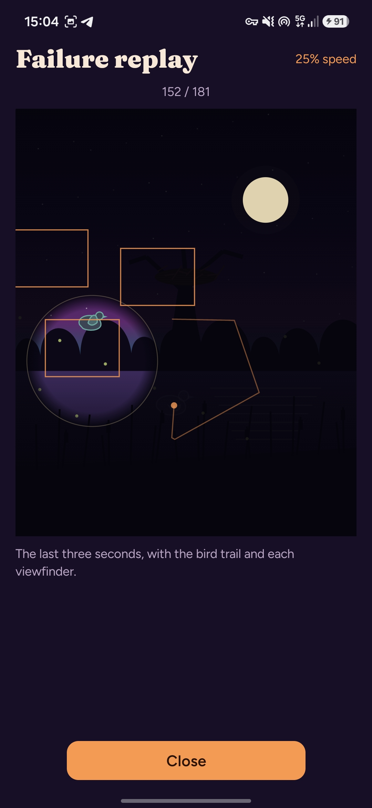

**English** · [Português (Portugal)](README.pt-PT.md)

<h1 align="center">
  
</h1>

<p align="center">
  A reflex game for Android about photographing ducks at dusk.<br>
  600 levels, twelve places and 48 birds. No ads, no tracking, no internet.
</p>

<p align="center">
  <a href="https://github.com/SyscallBrain/duck-night/releases/latest"></a>
  <a href="LICENSE"></a>
  
  
  
</p>

<p align="center">
  <a href="https://github.com/SyscallBrain/duck-night/releases/latest"><b>Download</b></a> ·
  <a href="#features">Features</a> ·
  <a href="#building-from-source">Building</a> ·
  <a href="#how-it-works">How it works</a> ·
  <a href="#contributing">Contributing</a>
</p>

## About

Duck Night takes the aim-and-react challenge of the classic arcade bird games and turns it into photography. Nobody hunts here: you frame the bird, press the shutter, and Farrusco, a Portuguese pointer, brings the developed photo back. Every photo is scored from 0 to 100 for centering, sharpness and wing pose, and the best shot of each species goes into your bird book.

The game is complete and runs entirely offline. It has no ads, accounts, analytics or purchases, and the only permission it asks for is vibration.

<p align="center">
  
  
  
  
</p>

## Features

### Campaign

- **600 levels** across twelve places, 50 per place, each playable in Easy, Medium and Hard.
- **Eight level types:** classic, double, flock, short roll, against the clock, protected birds, clays and bosses.
- **Twelve legendary birds,** each with its own trick and a three-photo album instead of a health bar: a thief crow that steals pages from your album, a grebe that surfaces somewhere else every time, a ghost that only shows itself before it turns.
- **Weather that changes the play:** wind, fog, snow, rain, night with a lamp, cover, diving birds and the golden duck.
- **48 birds:** 35 real species, from the mallard to the flamingo, plus the golden duck and the twelve legendary birds, each with its own speed, silhouette and flight pattern.

<details>
<summary><b>The twelve places</b></summary>
<br>

| # | Place | Introduces | Legendary bird |
|---:|---|---|---|
| 1 | Village Pond | the basics and the short roll | Old Mallard |
| 2 | Wheat Field | double birds and the village fair | Twin Teals |
| 3 | Windy Pinewood | wind and V-shaped flocks | Wind Goose |
| 4 | Misty Marsh | fog and the clock | Mist Goose |
| 5 | Stork Meadow | protected birds | Thief Crow |
| 6 | Snowy Ridge | snow and the film lever | Royal Snow Goose |
| 7 | Salt Pans | diving birds | Royal Grebe |
| 8 | Autumn Wood | cover and hopping birds | Imperial Mandarin |
| 9 | Heath at Night | the night and the lamp | Ghost Duck |
| 10 | Storm Delta | rain and soft lightning | Thunder Flock |
| 11 | Aurora Fjord | the golden duck and the multiplier | Golden Eider |
| 12 | Great Duck's Nest | everything together | The Great Duck |

</details>

### Ways to play

- **Three aiming modes:** tap the bird, move the phone, or steer a viewfinder and press the shutter. A calibration screen and a training field help you set them up.
- **More modes:** classic arcade (Games A, B and C), a daily challenge, free clay shooting, a fair gallery with a cork rifle and a two-player duel on one phone.
- **Failure replay:** the last three seconds before a bird escapes, at quarter speed, with its trail and every viewfinder you framed.

### Progression and presentation

- **Progression without pressure:** stars, photographer titles, a bird book, a boss gallery, 45 achievements, statistics, and dogs, cameras and viewfinders to unlock. No lives, no currency, nothing to buy.
- **Four visual themes:** Lakeside Dusk, Yellow Cassette, Cut Paper and Village Fair, with generated ambient music.
- **Two languages:** US English and European Portuguese. The game follows the phone's language, and **Settings → Language** switches it at any time.

## Accessibility

- Bigger birds, high-contrast outlines and color-blind palettes (deuteranopia, protanopia and tritanopia).
- Reduced motion, following the system setting or set by hand, and a soft flash that never fills the screen.
- Larger text, a left-handed layout, adjustable game speed and viewfinder tolerance, and aim assist on Easy.
- TalkBack reads the menus, the level information and the in-game announcements. Aiming itself still requires sight.

## Privacy

Duck Night collects nothing, and it is built so that it cannot.

- **No internet permission:** the app has no way to send data anywhere.
- **One permission only:** `VIBRATE`, for the shutter and photo feedback.
- No ads, accounts, analytics, third-party SDKs, Google Play Services or in-app purchases.
- Your progress stays on the device. You can export it to a file and import it back yourself.

CI enforces the permission and dependency policy with `tools/check_permissions.sh` and `tools/check_deps.sh`.

## Installation

1. Download the APK from the [latest release](https://github.com/SyscallBrain/duck-night/releases/latest).
2. Open it on your phone. Android asks once to allow installs from your browser or file manager.

Duck Night requires Android 8.0 (API 26) or newer. Release APKs are built and signed by the [release workflow](.github/workflows/release.yml) from the tagged commit.

## Building from source

| Tool | Version |
|---|---|
| JDK | 17 or newer |
| Android SDK | platform 37 and build tools |
| Gradle | wrapper included (9.8.0) |

```bash
git clone https://github.com/SyscallBrain/duck-night.git
cd duck-night

export JAVA_HOME=/path/to/jdk
export ANDROID_HOME=/path/to/android-sdk

./gradlew :core:test :leveltool:test :app:testDebugUnitTest   # unit tests, no emulator needed
./gradlew :app:assembleDebug                                   # APK in app/build/outputs/apk/debug/
```

The app build validates the level catalog in `content/` and packages it automatically.

Two scripts run the full set of checks. CI runs both on every pull request:

```bash
bash tools/verify.sh        # tests, lint, content, certificates, permissions and dependency policy
bash tools/repro_check.sh   # builds the unsigned release from two fresh clones and compares the APKs byte for byte
```

## How it works

**A deterministic engine.** The simulation in `:core` is plain Kotlin with no Android dependency. It uses only integer, fixed-point arithmetic and its own trigonometry table, so a level plays out exactly the same on every device and on the JVM. A round can be replayed from its seed and its input log, which is what powers the failure replay and resuming after the app is closed.

**Difficulty measured, not guessed.** Each of the 1,800 level variants is played hundreds of times by simulated photographers whose reaction time and aim error were measured against a real player on a phone. Every variant is tuned until its success rate falls inside the target band for its difficulty, and its two- and three-star scores come from those runs. A certificate stores the result together with a recorded three-star playthrough, and verification replays all of them: if the engine or the content ever drift, the check fails.

**Everything drawn in code.** Birds, the dog, the twelve scenes and the weather are painted with Compose on a single canvas. The APK contains no character bitmaps, and the sounds and music are generated by scripts in this repository.

## Project structure

| Path | Contents |
|---|---|
| `core/` | The engine: fixed-point math, flight, weather, bosses, photo scoring, replay and the simulated photographers. Pure Kotlin. |
| `leveltool/` | The content command line: generate, calibrate, certify, validate, report and export the catalog. |
| `app/` | The Android app: Compose UI, game loop, rendering, input, audio, vibration and saved progress. |
| `content/` | The published catalog: places, 600 levels, 48 species and 1,800 certificates. |
| `tools/` | Verification scripts, the content pipeline, the sound and music generators and the commit hook. |
| `docs/` | The asset and license inventory, and the images used in this README. |
| `fastlane/` | Store listing in both languages, with real screenshots. |

## Contributing

Bug reports, translations, accessibility feedback and pull requests are welcome. Please read [CONTRIBUTING.md](CONTRIBUTING.md) for the development setup, the commit conventions and the project rules. To report a bug, [open an issue](https://github.com/SyscallBrain/duck-night/issues) with your device model and Android version.

## License

The code is released under the [MIT License](LICENSE). The fonts are under the SIL Open Font License 1.1, and their license texts ship with the app in `app/src/main/assets/licenses/`. Every asset's origin and license is listed in [docs/ASSETS.md](docs/ASSETS.md).

Duck Night is an original game. Its birds, dog, scenes, sounds and music were all made for it, and it uses no art, sound or character from any other game.

## Author

**Tiago Correia** · [tiagorcorreia87@gmail.com](mailto:tiagorcorreia87@gmail.com) · [@SyscallBrain](https://github.com/SyscallBrain)
