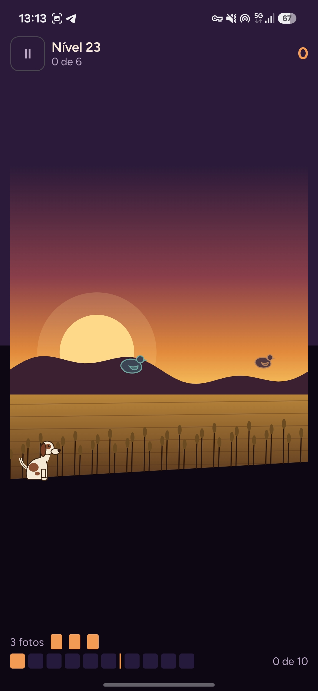
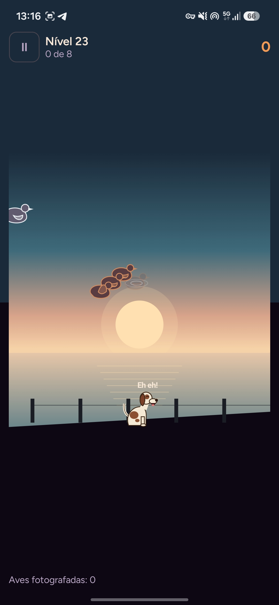

**English** · [Português (Portugal)](README.pt-PT.md)

<div align="center">


[](LICENSE)


<br>


</div>

<p align="center">
  
  
  
</p>
<p align="center">
  
  
  
</p>

## About

Duck Night takes the quick aim-and-react challenge of the classic arcade bird games and turns it into photography. Nobody hunts here: you frame the bird, press the shutter, and Farrusco, a Portuguese pointer, brings the developed photo back. Every photo is scored from 0 to 100 for centering, sharpness and wing pose, and the best one of each species goes into your bird book.

The game is complete and entirely offline. It has no ads, no accounts, no analytics and no purchases, and the only permission it asks for is vibration.

## Features

- **A full campaign.** 600 levels across twelve places, 50 per place, each playable in Easy, Medium and Hard.
- **Eight kinds of level.** Classic, double, flock, short roll, against the clock, protected birds, clays and bosses.
- **Twelve legendary birds.** Each boss has its own trick: a thief crow that steals pages from your album, a grebe that surfaces somewhere else every time, a ghost that only shows itself before it turns, a thunder flock that breaks apart with the lightning.
- **Weather that changes the play.** Wind, fog, snow, rain, night with a lamp, cover, diving birds and the golden duck, each drawn on screen and handled by the engine.
- **Forty-eight birds.** Thirty-five real species, from the mallard to the flamingo, plus the golden duck and the twelve legendary birds, each with its own speed, silhouette and flight pattern.
- **Three ways to aim.** Tap the bird, move the phone, or steer a viewfinder and press the shutter, with a calibration screen and a training field.
- **More to play.** Classic arcade (Games A, B and C), a daily challenge, free clay shooting and a fair gallery with a cork rifle, and a two-player duel on one phone.
- **Failure replay.** The last three seconds before a bird escapes, at quarter speed, with its trail and every viewfinder you framed.
- **Progression without pressure.** Stars, photographer titles, a bird book, a boss gallery, 45 achievements with progress, statistics, and three dogs, cameras and viewfinders to unlock. No lives, no currency, nothing to buy.
- **Four visual themes.** Lakeside Dusk, Yellow Cassette, Cut Paper and Village Fair, with generated ambient music.

## The twelve places

| # | Place | Introduces | Legendary bird |
|---:|---|---|---|
| 1 | Village Pond | the basics and the short roll | Old Mallard |
| 2 | Wheat Field | double birds and the village fair | Twin Teals |
| 3 | Windy Pinewood | wind and V-shaped flocks | Wind Goose |
| 4 | Misty Marsh | fog and the clock | Mist Goose |
| 5 | Stork Meadow | protected birds | Thief Crow |
| 6 | Snowy Ridge | snow and the film lever | Royal Snow Goose |
| 7 | Salt Pans | diving birds | Royal Grebe |
| 8 | Autumn Wood | cover and hopping birds | Imperial Mandarin |
| 9 | Heath at Night | the night and the lamp | Ghost Duck |
| 10 | Storm Delta | rain and soft lightning | Thunder Flock |
| 11 | Aurora Fjord | the golden duck and the multiplier | Golden Eider |
| 12 | Great Duck's Nest | everything together | The Great Duck |

## Accessibility

- Bigger birds, high-contrast outlines and color-blind palettes (deuteranopia, protanopia and tritanopia).
- Reduced motion, following the system setting or set by hand, and a soft flash that never fills the screen.
- Larger text, a left-handed layout, adjustable game speed and viewfinder tolerance, and aim assist on Easy.
- TalkBack reads the menus, the level information and the in-game announcements. Aiming itself still requires sight.

## Languages

US English and European Portuguese. The game follows the phone's language, and **Settings → Language** switches it at any time.

## Privacy

Duck Night is built to collect nothing.

- **No internet permission:** the app cannot send data anywhere.
- **One permission only:** `VIBRATE`, for the shutter and photo feedback.
- No ads, accounts, analytics, third-party SDKs, Google Play Services or in-app purchases.
- Your progress stays on the device. You can export it to a file and import it back yourself.

## Install

Download the signed APK from the [Releases](https://github.com/SyscallBrain/duck-night/releases) page and open it on your phone. Android asks once to allow installs from your browser or file manager.

## Building from source

| Tool | Version |
|---|---|
| JDK | 17 or newer |
| Android SDK | platform 37 and build tools |
| Gradle | wrapper included (9.8.0) |

```bash
export JAVA_HOME=/path/to/jdk
export ANDROID_HOME=/path/to/android-sdk

./gradlew :core:test :leveltool:test :app:testDebugUnitTest   # tests, no emulator needed
./gradlew :app:assembleDebug                                   # app/build/outputs/apk/debug/
```

Before a release, two scripts run the full check:

```bash
bash tools/verify.sh        # tests, lint, content, certificates, permissions and dependency policy
bash tools/repro_check.sh   # builds the release from two fresh clones and compares the APKs byte for byte
```

## How it works

**A deterministic engine.** The simulation in `:core` is plain Kotlin with no Android dependency. It uses only integer, fixed-point arithmetic and its own trigonometry table, so a level plays out exactly the same on every device and on the JVM. A round can be replayed from its seed and its input log, which is what powers the failure replay and the resume after the app is closed.

**Difficulty measured, not guessed.** Every one of the 1,800 level variants is played hundreds of times by simulated photographers whose reaction time and aim error were measured against a real player on a phone. Each variant is tuned until its success rate falls inside the target band for its difficulty, and its two- and three-star scores come from those runs. A certificate stores the result together with a recorded three-star playthrough, and the verification replays every one of them: if the engine or the content ever drift, the check fails.

**Everything drawn in code.** Birds, the dog, the twelve scenes and the weather are painted with Compose on a single canvas. There are no bitmaps of characters in the APK, and sounds and music are generated by scripts in this repository.

## Project structure

| Path | Contents |
|---|---|
| `core/` | The engine: fixed-point math, flight, weather, bosses, photo scoring, replay and the simulated photographers. Pure Kotlin. |
| `leveltool/` | The content command line: generate, calibrate, certify, validate, report and export the catalog. |
| `app/` | The Android app: Compose UI, game loop, rendering, input, audio, vibration and saved progress. |
| `content/` | The published catalog: places, 600 levels, 48 species and 1,800 certificates. |
| `tools/` | Verification scripts, the content pipeline and the commit hook. |
| `fastlane/` | Store listing in both languages, with real screenshots. |

## Contributing

Bug reports, translations, accessibility feedback and pull requests are welcome. See [CONTRIBUTING.md](CONTRIBUTING.md) for the setup and the conventions.

## License

The code is released under the [MIT License](LICENSE). The fonts are under the SIL Open Font License 1.1, and their license texts ship with the app in `app/src/main/assets/licenses/`.

Duck Night is an original game. Its birds, dog, scenes, sounds and music were all made for it, and it uses no art, sound or character from any other game.

## Author

**Tiago Correia** · [tiagorcorreia87@gmail.com](mailto:tiagorcorreia87@gmail.com) · [@SyscallBrain](https://github.com/SyscallBrain)
