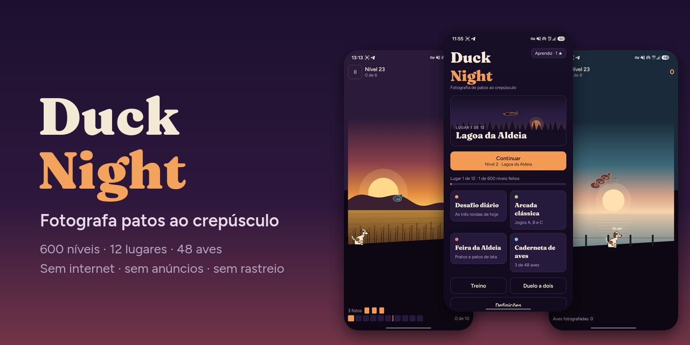
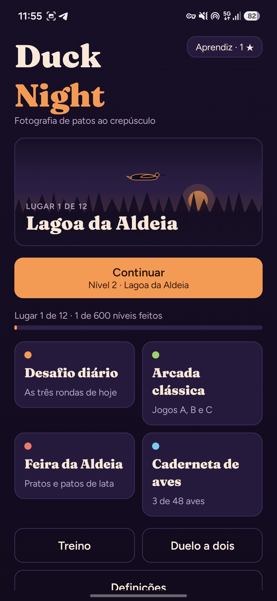
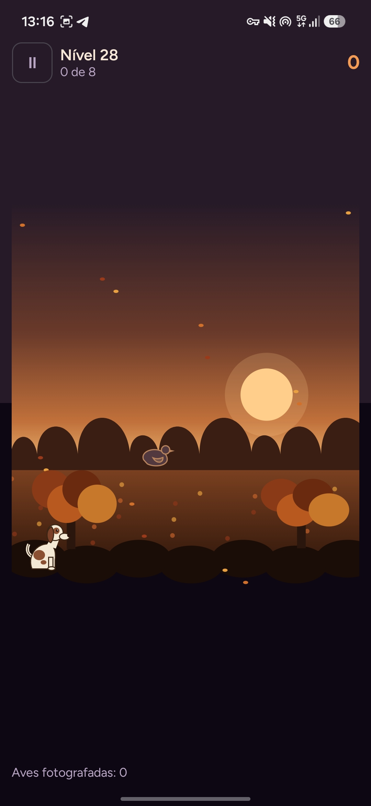
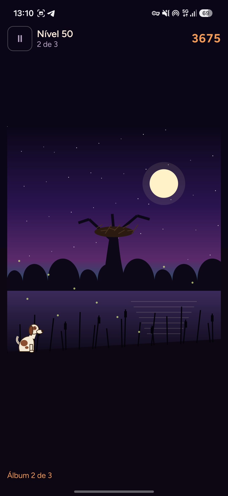
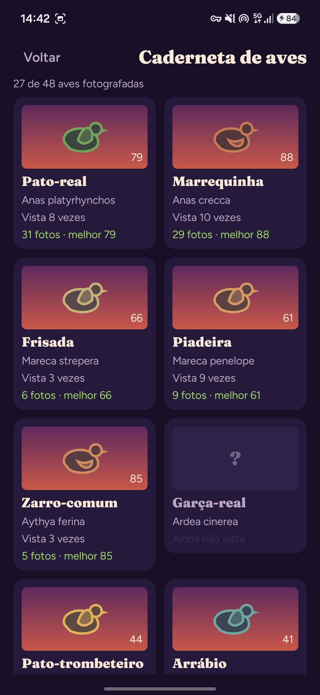

[English](README.md) · **Português (Portugal)**

<div align="center">




[](LICENSE)


<br>


</div>

<p align="center">
  
  
  
</p>
<p align="center">
  
  
  
</p>

## Sobre

O Duck Night pega no desafio rápido de apontar e reagir dos jogos clássicos de aves das arcadas e transforma-o em fotografia. Aqui não se caça: enquadras a ave, carregas no obturador, e o Farrusco, um perdigueiro português, traz a foto revelada. Cada foto vale de 0 a 100 pela centragem, pela nitidez e pela pose da asa, e a melhor de cada espécie fica na tua caderneta de aves.

O jogo está completo e funciona sem internet. Não tem anúncios, contas, análises de utilização nem compras, e a única permissão que pede é a vibração.

## Funcionalidades

- **Uma campanha completa.** 600 níveis em doze lugares, 50 por lugar, cada um em Fácil, Médio e Difícil.
- **Oito tipos de nível.** Clássico, dupla, bando, rolo curto, contra-relógio, aves protegidas, pratos e chefes.
- **Doze aves lendárias.** Cada chefe tem a sua manha: um corvo ladrão que te rouba páginas do álbum, um mergulhão que sai sempre noutro sítio, um fantasma que só se mostra antes de mudar de rumo, um bando do trovão que se desfaz com o relâmpago.
- **Tempo que muda o jogo.** Vento, nevoeiro, neve, chuva, noite com lanterna, cobertura, aves que mergulham e o pato dourado, todos desenhados no ecrã e tratados pelo motor.
- **Quarenta e oito aves.** Trinta e cinco espécies reais, do pato-real ao flamingo, mais o pato dourado e as doze aves lendárias, cada uma com a sua velocidade, silhueta e padrão de voo.
- **Três formas de apontar.** Tocar na ave, mover o telemóvel, ou guiar um visor e premir o obturador, com um ecrã de calibração e um campo de treino.
- **Mais para jogar.** Arcada clássica (Jogos A, B e C), desafio diário, tiro aos pratos livre e galeria de feira com espingarda de rolha, e duelo a dois no mesmo telemóvel.
- **Repetição do falhanço.** Os últimos três segundos antes de uma ave fugir, a um quarto da velocidade, com o rasto dela e todos os visores que enquadraste.
- **Progressão sem pressão.** Estrelas, títulos de fotógrafo, caderneta de aves, galeria de chefes, 45 conquistas com progresso, estatísticas, e três cães, máquinas e visores para desbloquear. Sem vidas, sem moeda, nada para comprar.
- **Quatro temas visuais.** Lagoa ao Crepúsculo, Cassete Amarela, Papel Recortado e Barraca de Feira, com música ambiente gerada.

## Os doze lugares

| # | Lugar | Introduz | Ave lendária |
|---:|---|---|---|
| 1 | Lagoa da Aldeia | o básico e o rolo curto | Pato-real Velho |
| 2 | Campo de Trigo | aves aos pares e a feira da aldeia | Marrecos Gémeos |
| 3 | Pinhal do Vento | vento e bandos em V | Ganso do Vento |
| 4 | Pântano das Névoas | nevoeiro e contra-relógio | Ganso das Névoas |
| 5 | Prado das Cegonhas | aves protegidas | Corvo Ladrão |
| 6 | Serra da Neve | neve e a alavanca do rolo | Ganso-das-neves Real |
| 7 | Salinas | aves que mergulham | Mergulhão Real |
| 8 | Bosque de Outono | cobertura e aves que saltam | Mandarim Imperial |
| 9 | Charneca à Noite | a noite e a lanterna | Pato Fantasma |
| 10 | Delta da Tempestade | chuva e relâmpagos suaves | Bando do Trovão |
| 11 | Fiorde da Aurora | o pato dourado e o multiplicador | Eider Dourado |
| 12 | Ninho do Grão-Pato | tudo junto | O Grão-Pato |

## Acessibilidade

- Aves maiores, contorno de alto contraste e paletas para daltonismo (deuteranopia, protanopia e tritanopia).
- Movimento reduzido, a seguir a definição do sistema ou escolhido à mão, e um flash suave que nunca enche o ecrã.
- Texto maior, jogo para canhotos, velocidade do jogo e tolerância do visor ajustáveis, e mira assistida em Fácil.
- O TalkBack lê os menus, a informação dos níveis e os anúncios do jogo. Apontar continua a exigir visão.

## Idiomas

Inglês americano e português europeu. O jogo segue a língua do telemóvel, e em **Definições → Idioma** podes mudá-la quando quiseres.

## Privacidade

O Duck Night foi feito para não recolher nada.

- **Sem permissão de internet:** a app não consegue enviar dados para lado nenhum.
- **Uma só permissão:** `VIBRATE`, para o obturador e as fotos.
- Sem anúncios, contas, análises de utilização, SDKs de terceiros, Google Play Services nem compras na app.
- O teu progresso fica no telemóvel. Podes exportá-lo para um ficheiro e importá-lo tu próprio.

## Instalação

Descarrega o APK assinado na página de [Releases](https://github.com/SyscallBrain/duck-night/releases) e abre-o no telemóvel. O Android pede uma vez para permitir instalações a partir do navegador ou do gestor de ficheiros.

## Compilar a partir do código

| Ferramenta | Versão |
|---|---|
| JDK | 17 ou mais recente |
| Android SDK | plataforma 37 e build tools |
| Gradle | wrapper incluído (9.8.0) |

```bash
export JAVA_HOME=/caminho/para/jdk
export ANDROID_HOME=/caminho/para/android-sdk

./gradlew :core:test :leveltool:test :app:testDebugUnitTest   # testes, sem emulador
./gradlew :app:assembleDebug                                   # app/build/outputs/apk/debug/
```

Antes de cada versão, dois scripts fazem a verificação completa:

```bash
bash tools/verify.sh        # testes, lint, conteúdo, certificados, permissões e política de dependências
bash tools/repro_check.sh   # compila a release a partir de dois clones limpos e compara os APKs byte a byte
```

## Como funciona

**Um motor determinístico.** A simulação no `:core` é Kotlin puro, sem dependências do Android. Usa só aritmética inteira em vírgula fixa e uma tabela trigonométrica própria, por isso um nível joga-se exatamente da mesma forma em qualquer telemóvel e na JVM. Uma ronda pode ser repetida a partir da semente e do registo de toques, e é isso que alimenta a repetição do falhanço e a retoma depois de a app ser fechada.

**Dificuldade medida, não adivinhada.** Cada uma das 1 800 variantes de nível é jogada centenas de vezes por fotógrafos simulados, cujo tempo de reação e erro de pontaria foram medidos contra um jogador real num telemóvel. Cada variante é afinada até a taxa de sucesso cair na banda da sua dificuldade, e as pontuações de duas e três estrelas saem dessas jogadas. Um certificado guarda o resultado com uma jogada de três estrelas gravada, e a verificação repete todas: se o motor ou o conteúdo alguma vez divergirem, a verificação falha.

**Tudo desenhado em código.** As aves, o cão, os doze cenários e o tempo são pintados com o Compose num único canvas. O APK não traz imagens de personagens, e os sons e a música são gerados por scripts deste repositório.

## Estrutura do projeto

| Pasta | Conteúdo |
|---|---|
| `core/` | O motor: matemática em vírgula fixa, voo, tempo, chefes, pontuação das fotos, repetição e fotógrafos simulados. Kotlin puro. |
| `leveltool/` | A linha de comandos do conteúdo: gerar, calibrar, certificar, validar, relatar e exportar o catálogo. |
| `app/` | A app Android: interface Compose, ciclo de jogo, desenho, entrada, som, vibração e progresso guardado. |
| `content/` | O catálogo publicado: lugares, 600 níveis, 48 espécies e 1 800 certificados. |
| `tools/` | Scripts de verificação, o pipeline de conteúdo e o hook de commits. |
| `fastlane/` | A ficha da loja nas duas línguas, com capturas reais. |

## Contribuir

Relatórios de erros, traduções, comentários sobre acessibilidade e pull requests são bem-vindos. Vê o [CONTRIBUTING.md](CONTRIBUTING.md) para a preparação e as convenções.

## Licença

O código é distribuído sob a [licença MIT](LICENSE). As fontes estão sob a SIL Open Font License 1.1, e os textos das licenças vêm com a app em `app/src/main/assets/licenses/`.

O Duck Night é um jogo original. As aves, o cão, os cenários, os sons e a música foram todos feitos para ele, e não usa arte, som nem personagens de nenhum outro jogo.

## Autor

**Tiago Correia** · [tiagorcorreia87@gmail.com](mailto:tiagorcorreia87@gmail.com) · [@SyscallBrain](https://github.com/SyscallBrain)
